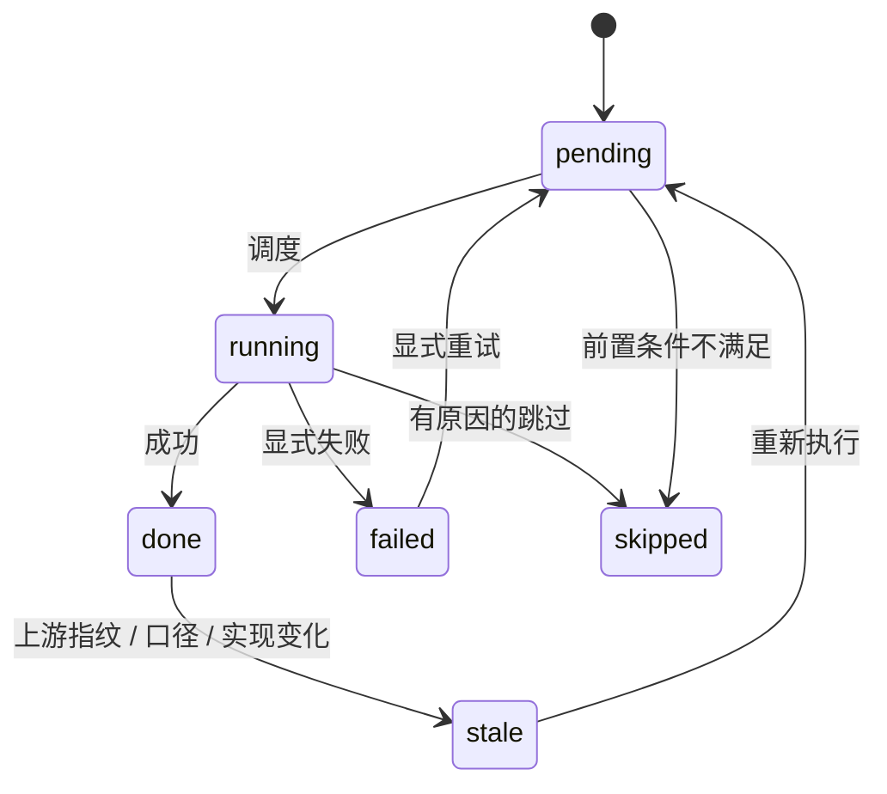

# 03 · 上层编排层

> 本篇定义唯一有权的一层：固定八步、工位与料包契约、状态机、一次性事件、唯一裁判，以及整体跑与单步跑为什么共用一套逻辑。

---

## 1. 定位：唯一有权

编排层决定**按什么顺序、按什么口径跑**，并且是唯一有权做下列动作的地方：

| 动作 | 为什么必须独占 |
|---|---|
| 开执行、推进状态机 | 出现第二套状态就无法判断「是否真的跑过」 |
| 触发一次性事件（揭示、计数、发布） | 可重复触发就等于免费重试 |
| 登记试验计数 | 计数是多重检验门槛的输入，不能被少报或清零 |
| 注入冻结口径与调用单 | 口径只有一个来源 |
| 发布结论 | 唯一裁判，判据不分散 |

能力层只有计算权。编排层不实现算法，能力层不决定顺序。

---

## 2. 工位不是函数

把流水线拆成函数很容易，但不产生「单步可跑」的能力：函数之间可以共享闭包变量、依赖调用顺序、把活对象塞进全局状态——整体跑时都工作，单独起一个进程跑其中一步时全部失效。

工位是**有输入契约、有输出契约、有副作用等级、有可独立重建能力的执行单元**。判断拆得对不对只有一条标准：

> 关掉整个进程，只保留落盘产物与冻结方案，能不能单独把这一步重跑出来？

答案是「不能」，就说明还有隐式依赖没切断。

---

## 3. Parcel：工位间唯一合法的数据载体

| 字段 | 说明 |
|---|---|
| `ticket_id` | 所属执行 |
| `station` / `station_revision` | 产出工位与契约版本 |
| `payload_ref` | 产物落盘位置；**不存放活对象** |
| `digest` / `lineage` | 产物指纹；上游 `(station, digest)` 序列 |
| `evidence` | 观测记录，**只允许事实，不允许结论** |
| `origin` | `run` / `step` / `commit` / `resume` / `cache` |
| `status` / `started_at` / `seconds` / `error` | 可观测性 |
| `policy_digest` | 产出时的口径锚点 |

三条硬约束：

1. Parcel 不可变。修改等于产出一份新 Parcel，旧的不删。
2. Parcel 只落盘。任何模型实例、连接句柄、生成器、内存视图都必须能由 `payload_ref` 重建；不能重建的对象不允许跨工位传递。
3. Parcel 只带 `evidence`。结论字段只能由裁决工位经唯一裁判写入。

**重建失败必须显式失败**。降级成「本步跳过、产物为空」是最危险的形态：流水线显示成功，结论却建立在空输入上。

指纹覆盖：工位与契约版本、实现名与版本、参数、全部输入引用、冻结口径、上游血缘。

---

## 4. 工位规格

| 字段 | 含义 |
|---|---|
| `name` / `revision` | 稳定标识；改名会使历史执行失效。输入/输出 schema 变化才升契约版本 |
| `inputs` / `outputs` | 所需上游 Parcel 的键与 schema |
| `default_impl` | 基线中的默认实现（含版本） |
| `names` | 本工位可指定的实现名及其参数定义；只有第 4 步是开放的 |
| `schema` / `parameter_class` | 专属参数路径、类型、范围；哪些属于构成性 |
| `side_effect` | `pure` / `repeatable` / `append_only` |
| `standalone` | `allowed` / `requires_frozen_plan` / `probe_only` |
| `guards` | 执行前后条件 |

`standalone = probe_only` 用于 `append_only` 工位：它可以被单独重算以观察结果，但**没有任何提交式单步**。

规格是**数据表**，不是类继承体系。顺序、默认实现、参数定义都只改数据。

---

## 5. 唯一执行入口

```
execute(station, blueprint, resolved_inputs) -> Parcel
```

- `blueprint`：编译期冻结的只读视图。
- `resolved_inputs`：编排层按 `station.inputs` 从产物索引解析，逐项校验指纹。
- 内部顺序：按名字解析 `实现@版本` → 组装调用单（`params` / `inputs` / `policy_view` / `runtime_facts` 四个通道，外加 `composed` 子调用）→ 校验参数与签名 → 执行 → 落盘 Parcel → 写结构化记录 → 返回。

**四个通道的组装是执行器的职责，不是实现的职责。** 实现拿到的是一个已经装好的调用单，因此它既不能自选口径（`policy_view` 由编译器填），也不能自报计数（`runtime_facts` 由账本快照填），还不能临时去调一个没声明的能力（`composed` 由编译器按 `composes` 预构造）。

**整体跑与单步跑都走这个函数**，没有第二份执行逻辑，也没有「单步专用简化版」。

---

## 6. 八步详规

### 6.1 Boundary · 研究边界

| 项 | 内容 |
|---|---|
| 职责 | 逐时点判定哪些标的可观测、哪些可交易；声明流动性分层与研究口径 |
| 输入 | 冻结方案中的边界参数、存续事实源、逐时点成交额 |
| 输出 | `ScopeParcel`：两张掩码、分层标签、逐格排除理由码 |
| 默认实现 | 滚动流动性池（只用历史窗口信息） |
| 名字空间 | 单实现；存续事实源、分层规则、准入规则链是**内部组件**，固定串联 |
| 构成性参数 | 池规模、分层口径、准入下限、时间轴 |
| 副作用 / 单步 | `repeatable` / 允许，需锚定冻结方案 |

两张掩码必须分开：用几百个标的做覆盖与中性化、把权重约束在流动性足够的一层，是两件不同的事；合成一张会把「可观测」误当「可交易」。排除理由码必须逐格可查，否则下游无法区分「结构性缺席」与「数据缺口」。

### 6.2 Panel · 因果面板

| 项 | 内容 |
|---|---|
| 职责 | 装配逐时点面板，做对齐、因果校验、质量门禁 |
| 输入 | `ScopeParcel`、原始字段流、固化的数据版本引用 |
| 输出 | `PanelParcel`：对齐后的字段面板、数据版本、因果校验报告 |
| 默认实现 | 逐时点对齐（缺失用空值表示，不做静默前向/后向填充） |
| 名字空间 | 单实现；字段流读取、对齐、因果探针、质量门禁是**内部组件** |
| 构成性参数 | 数据版本引用（编译期固化） |
| 副作用 / 单步 | `repeatable` / 允许 |

任意时点的取值只能依赖该时点及之前的信息。丢弃未收盘的时间末端、记录数据版本，都属于本工位的门禁职责，不能留给下游各自处理。**「指定交易所名」是参数，不是这一步的算法选择。**

### 6.3 Target · 标签与变换

| 项 | 内容 |
|---|---|
| 职责 | 生成预测目标、截面变换、中性化，处理有效截面宽度 |
| 输入 | `PanelParcel`、`caliber.execution`、`caliber.label` |
| 输出 | `LabelParcel`：目标、截面分数、有效宽度序列、**逐时点有效掩码**、丢弃计数 |
| 默认实现 | 固定跨度前瞻收益 + 逐截面排序/标准化 |
| 名字空间 | 单实现；目标定义、变换链、中性化器是**内部组件** |
| 构成性参数 | 全部来自 `caliber.label` 与 `caliber.execution`，本工位不得自带 |
| 副作用 / 单步 | `pure` / 允许 |

有效截面宽度随时间变化时，截面统计不是同一个量。**丢弃权在本工位，且只按预注册规则**：`min_width` 与 `width_policy` 决定 `valid_bar_mask`，下游一律按该掩码过滤、不再自行判定。丢弃了多少、丢在哪一段必须作为观测写入料包，否则「研究窗口被静默缩短」无法被发现。

`rebalance < horizon` 时标签重叠，必须由 `caliber.label.overlap_policy` 显式声明处理方式，否则编译失败（C22）。重叠标签当独立观测是横截面研究里最容易被忽略的虚假显著来源，详见 `06-evaluation.md` §7。

### 6.4 Search · 候选生成

| 项 | 内容 |
|---|---|
| 职责 | 按算法名产出候选信号与谱系 |
| 输入 | `LabelParcel`、`PanelParcel`、试验族声明、种子 |
| 输出 | `CandidateParcel`：统一候选集合、谱系、生成元数据 |
| 默认实现 | 符号搜索 + 先验字典混合 |
| 名字空间 | **开放**：挖掘算法与内置因子清单，接口见 `02-mining-interface.md` |
| 构成性参数 | 搜索空间、试验族、种子、候选上限 |
| 副作用 / 单步 | **`append_only`（触发 Budget 事件）** / 只读重算允许；提交式重放会消耗预算 |

试验计数由编排层统一代写，算法不能自己写预算。计数分两段：**`fit` 内每次 `ctx.fitness` 调用**（键为 `candidate_id`，重复不记）与 **`CandidateSet` 落盘后的一次性登记**，两段合并去重，结果是 `n_trials` 的唯一来源。语法与算子白名单在编译期拒绝任何访问未来信息的构造，而不是运行时靠约定。多个算法共用一个候选集合、一次计数，禁止按结果挑算法。

`ctx.fitness` 由执行器构造，三件事在闭包内完成：调 `evaluate`（与 Evidence 同一实现同一版本）、按 `mine_slice` 裁范围、登记一次试验。执行器进入 `fit` 前保存 `random.getstate()`，退出后还原；若已有另一个自适应算法在跑，直接 `E2009` 拒绝——**不做排队，因为排队会让等待时间进日志、进不了指纹，两次执行会得到不同的偶发行为**。

### 6.5 Evidence · 证据采集

| 项 | 内容 |
|---|---|
| 职责 | 分层粗筛 → 零分布精算 → 指标与成本归因 |
| 输入 | `CandidateParcel`、面板、标签、**`caliber.allocate` 与 `caliber.net`（经子调用）** |
| 输出 | `EvidenceParcel`：逐候选观测、零分布、指标、成本归因、单因子净表现 |
| 默认实现 | 两阶段漏斗（廉价筛 → 精算零分布），幸存者按同一构造建仓并扣成本 |
| 名字空间 | 单实现；漏斗阶段、指标、零分布模型是**内部组件** |
| 构成性参数 | 显著性判据口径；构造与成本**只读 `caliber`，不得自带** |
| 副作用 / 单步 | `pure` / 允许 |

本工位**只产观测，不产结论**。零分布模型的构造方式属于口径，必须随方案冻结；把「换一个更宽松的零分布」做成可随手拨的旋钮，等于绕开显著性判据。多种统计变体只允许走只读诊断通道。

单因子的净收益不是「按某个顺手的方式建仓再扣成本」：它必须调用与组合层**同一个** `allocate` 与 `backtest`，参数逐项来自 `caliber`。单因子的暴露本身就是 `(T,N)` 的横截面分数，构造时走同一套分位与权重规则；与组合层的差别只有「合成前的因子个数为一」，不是「换一种建仓方式」。这条由 C20 在编译期锁住，见 `06-evaluation.md` §2。

### 6.6 Verdict · 唯一裁决

| 项 | 内容 |
|---|---|
| 职责 | 消费证据，发布通过 / 拒绝 / 待观察 |
| 输入 | `EvidenceParcel`、试验预算状态、冻结判据 |
| 输出 | `VerdictParcel`：逐候选结论与拒绝原因 |
| 默认实现 | Sentinel（唯一实现，**不提供宽松默认**） |
| 名字空间 | **唯一且不可配**：配置里不能指定第二个实现 |
| 构成性参数 | 全部判据阈值 |
| 副作用 / 单步 | **`append_only`（裁决记录）** / 只读复核允许；**不得反复重跑到改变结论** |

Sentinel 缺失或严格模式未注入时，编译与执行都必须失败。多重检验校正、试验计数、成本可交易性判据在同一处一次性应用，避免分散在各工位里各自打折。

### 6.7 Portfolio · 合成与回测

| 项 | 内容 |
|---|---|
| 职责 | 去共线 → 固定权重合成 → 带约束持仓 → 净成本后表现 |
| 输入 | `VerdictParcel`、**编译期冻结的组合域**、候选暴露、掩码、分层、`caliber` |
| 输出 | `PortfolioParcel`：合成分数、权重、成本明细、净表现、成员谱系、域摘要、**证据等级** |
| 默认实现 | 三段窗口（拟合 / 隔离 / 评估）内一次性拟合的固定权重 + 分层分位持仓 |
| 名字空间 | **封闭多选**：合成器，能选不能加；构造与成本由 `caliber` 决定，本工位不可选 |
| 构成性参数 | 域范围、三段窗口边界；构造与成本只读 `caliber` |
| 副作用 / 单步 | `repeatable` / 允许 |

权重必须全期一次性拟合并落盘，成员谱系不可为空；约束由 `caliber.allocate` 注入，实现不能自行绕过。

**三段窗口缺一不可**：`fit`（估权重）／`embargo`（隔离标签重叠，长度 ≥ `horizon`）／`eval`（算净表现）。`fit.start ≥ max(available_from)`、`fit.end + embargo ≤ eval.start`、`eval.end ≤ 搜索区间末端`，三条都由 C21 在编译期校验。只约束拟合起点、不约束评估起点，字面上就允许「全期拟权重、同段评估」——那是组合层自制样本内。

**本工位的净表现是样本内构造诊断，不是可交易结论。** 它用来判断口径是否可行、约束是否过紧、换手是否过高；可交易性结论只在认证段用同一判据复算后发布。`PortfolioParcel` 必须携带这个证据等级，发布流程只接受认证段的结论。

**成员资格不是本工位能决定的**：组合只消费冻结的组合域，既不直接读全部已登记因子，也不在运行期按表现增删成员。域的规则写在 `05-contracts.md` §3，构造口径写在 `06-evaluation.md`。

### 6.8 Certify · 认证与归档

| 项 | 内容 |
|---|---|
| 职责 | 样本外与前向认证、报告、归档、触发发布 |
| 输入 | 全部上游 Parcel、执行状态 |
| 输出 | `CertificateParcel`：认证结论、报告、可复现清单 |
| 默认实现 | 固定切分 + 前向验证 + 一次性留出 |
| 名字空间 | 单实现；切分策略、账本、发布器是**内部组件** |
| 副作用 / 单步 | `repeatable` + 触发 Publish 事件 / 允许生成报告；发布默认不触发 |

认证结论必须回灌 Sentinel 的同一套判据，不能另起一套更宽松的「展示用」指标。只允许预注册一种主切分，其余仅作只读诊断。

---

## 7. 状态机



| 状态 | 含义 |
|---|---|
| `pending` / `running` | 尚未执行 / 执行中 |
| `done` | 成功且产物已登记 |
| `failed` | 显式失败，带错误摘要 |
| `skipped` | **必须带原因**，例如「无候选通过裁决」 |
| `stale` | 上游或口径变化导致产物不再可信 |

两条规则：「没有候选通过裁决」是**结果**不是失败，记为 `skipped(reason)`；「验证折数为 0」「面板重建失败」「依赖缺失」是**失败**，不得写成绿色跳过记录。

---

## 8. 副作用分级

| 级别 | 定义 | 单步默认 | 典型工位 |
|---|---|---|---|
| `pure` | 无外部写入 | 可任意重复 | Target、Evidence |
| `repeatable` | 可重入写盘，同指纹覆盖 | 可重复（隔离目录），`--commit` 可覆盖正式产物 | Boundary、Panel、Portfolio、Certify |
| `append_only` | 全局账本写入，不可撤销 | **只允许只读重算，禁止 `--commit`** | Search（Budget）、Verdict（裁决记录） |

分级把「能不能反复跑」变成编译期可见的属性。`append_only` 工位**没有提交式单步**：提交就等于要么重复计数、要么改变已发布结论，两条都是免费重试。想改这一层只能走完整的整体执行。

`repeatable` 工位的 `--commit` 也只能推进状态机与覆盖产物，**不触发任何事件**。事件只由整体执行触发；否则「单独把认证工位提交到通过」就是一条发布后门。

---

## 9. 事件不是工位

| 事件 | 绑定 | 触发时机 | 整体恢复时 | 单步默认 |
|---|---|---|---|---|
| Reveal | 执行 | **开执行之后、Boundary 之前**：确定保留窗口与保留资产在本次执行中是否可见 | 读取已记录结果，不重新揭示 | 复用，禁止重新揭示 |
| Budget | 执行 + 试验族 | 候选集合落盘后按实测数登记 | 从记录值继续，不重复计数 | 只读重算不写 |
| Publish | 执行 | 认证通过后 | 已发布则不重复 | 不触发 |

事件结果写入执行状态记录。把事件做成工位，是「同一窗口被重复揭示」「反复重跑到通过」这类事故最常见的来源。

**Reveal 必须在 Boundary 之前**，因为「保留区是否可见」决定面板装不装那段数据；如果放在面板门禁之后，Boundary 就已经在不知道可见性的情况下判过存续与分层了。

但这里有一个容易看错的地方：**Boundary 需要的是「保留区声明」，不是「保留区数据」**。声明（哪些时间轴、哪些资产被保留）是编译期常量，进 `caliber` 与时间轴配置，因此 Boundary 能逐格标出 `reserved` 理由码；保留区的**数值**只有 Reveal 之后才可见。声明与数据分开，既不需要提前揭示，也不会让排除理由缺一块。

---

## 10. 整体跑、单步跑与恢复

### 整体跑

```
flow run --plan <plan> [--through <station>] [--on <ticket>]
```

整体跑**不负责采集**：共享事实版本由前置维护动作在编译之前发布，编译只把别名固化成精确引用，并做只读适用性校验。引用缺失、门禁未通过或适用性不满足 → 编译失败且不创建执行，不得自动补采。

| 步骤 | 动作 |
|---|---|
| 1 | 编译三层配置 → 冻结方案（失败即停止，不创建执行） |
| 2 | 开 Ticket，写入四个指纹、基线版本、环境快照 |
| 3 | 触发 **Reveal**：确定保留区可见性并记账（只此一次） |
| 4 | 按固定顺序执行八工位；每步校验上游 Parcel 指纹；Search 落盘后触发 **Budget** |
| 5 | 通过后触发 **Publish** |
| 6 | 归档：状态、产物索引、报告、可复现清单 |

只有 `Reveal` 是前置事件。`Budget` 不能前置：它登记的是**实测产出的候选数**，在候选产生之前无法确定；把它写成前置声明，就等于允许「先报一个数再产候选」。

`--through <station>` 是「跑到某一步为止」：仍从第一步开始，在指定工位后正常停止，给出完整可复现的中间状态，不写最终结论。

### 单步跑

```
flow station <name> --on <ticket> [--probe | --commit]
```

| 规则 | 语义 |
|---|---|
| **口径锚点** | 必须读取该执行已冻结的方案，**禁止重新合并三层配置**；命令行只允许传操作性参数 |
| **依赖校验** | 按 `inputs` 检查上游 Parcel 存在且指纹匹配；缺失或失配即失败并给出修复提示 |
| **失效检查** | 上游标记失效时拒绝执行 |
| **输出隔离** | 默认写 `steps/<seq>-<Station>-<hash>/`，标 `origin=step`，不覆盖正式产物 |
| **状态机** | 默认不推进正式状态、不写事件账本、不产生可发布结论 |
| **副作用** | `append_only` 工位**禁止 `--commit`**；`repeatable` 工位 `--commit` 可覆盖产物但**不触发事件** |
| **裁决** | 单步复核不得改变已发布结论；新结论只能在完整链上产生 |
| **退出码** | `0` 成功 / `1` 工位失败或依赖不满足 / `2` 用法或编译错误 / `3` 契约违反 |

单步默认语义是 **观察，不提交**。它解决调试、复现、操作性对照三类正当需求；不解决、也明确禁止「反复重放裁决工位直到得到想要的结论」。

两条硬边界：**提交不等于推进事件**（事件只能由整体执行触发），**提交不等于缩短链条**（认证与发布只在完整链上发生）。这两条合起来关掉了「单步重试到通过」的唯一入口。

恢复执行（resume）本质上是**从第一个未完成工位开始、把剩余工位依次交给同一个执行器**，产物标 `origin=resume`。恢复前必须校验四个锚点指纹与基线版本，任一不匹配即拒绝恢复，而不是「尽量继续」。

### 失效传播

| 触发 | 传播 |
|---|---|
| 基线升版 / 构成性参数变化 | 新试验族；旧执行保持可复现，但产物不与新执行混用 |
| 实现或参数变化 | 该工位及其全部下游标 `stale` |
| 上游 Parcel 被 `--commit` 覆盖 | 下游全部标 `stale`，重跑后才可认证 |
| 数据版本变化 | 从 Panel 起全部下游标 `stale` |

---

## 11. 命令面与观测

**命令名、参数与退出码以 `09-app-storage.md` §2.2 为唯一清单。** 本节只讲编排层自己的观测要求，不再维护第二份命令表——上一版这里有一套名字、`s0/README` 有另一套、`09` 有第三套，开发时无法回答「到底有哪几条命令」。

与编排语义直接相关的三条（名字与参数以 09 为准）：

| 命令形态 | 编排层要保证的事 |
|---|---|
| `flow run --plan ...` | 整体跑；`--through <station>` 只跑到指定工位，`--on <ticket>` 是恢复执行而不是重跑 |
| `flow station <name> --on <ticket>` | 单步观察；加 `--commit` 才推进账本，未加时产物进隔离目录且不参与认证 |
| `flow inspect --on <ticket>` | 状态、指纹链、失效传播、事件；**只读**，不得顺手触发重算 |

| 信号 | 要求 |
|---|---|
| 每工位一条结构化记录 | 工位、契约版本、实现、参数摘要、耗时、状态、产物指纹 |
| 失败 | 非零退出码 + 失败状态 + 可读错误 |
| 跳过 | 必须带 `reason`，区分「结果性跳过」与「前置不满足」 |
| 缓存命中 | 标 `origin=cache`，保留血缘与原始指纹 |
| 单步产物 | 标 `origin=step`，隔离目录，不参与正式认证 |
| 日志归属 | 工位日志与产物同目录同指纹；执行记录在 Ticket 根层；维护日志不归属任何执行 |
| 环境快照 | 实现/依赖版本、时钟基准、随机源、资源上限、凭据引用名；不含凭据值 |
| 可复现清单 | 四个锚点指纹、基线版本、试验族、种子、数据版本引用、实现版本、`caliber` 取值、环境摘要 |

**可观测性的判据**：只看结构化记录，就能判断一次执行是否真的跑过、哪一步失败、结论基于哪份口径。任何需要「打开产物猜」的情况都算缺口。

> 一句话：**单步改变的是观察粒度，不是结论的产生方式。**
