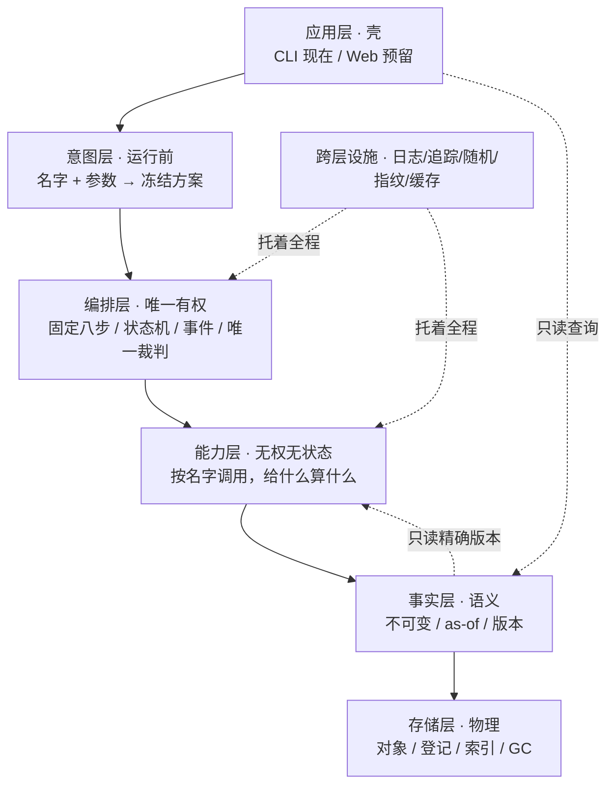

# V5 · 声明式研究流水线

> 状态：**实现已推进到 S7**（契约、供给链、搜索/评估、组合/回测、单步、认证均已落地）。本目录是 V5 唯一文档中心，**全量导航见 `INDEX.md`**；当前实现差距、待修 P0/P1 与需更正的文档陈述，统一见 `reviews/summary/v5_module_review_findings_detailed_20261118.md`。
> 本目录自洽：所有概念在本目录内定义，不依赖任何外部材料。

---

## 1. 一页速读

整套系统是**七层**，从下往上：

| 层 | 回答什么 | 权限 |
|---|---|---|
| **应用层** | 用户怎么发起、怎么看结果 | 只有壳：不含业务逻辑、不含口径参数；现在只有 CLI，Web 预留 |
| **意图层** | 这次要跑什么 | 把配置编译成冻结方案；跑起来之后不许再改 |
| **编排层** | 按什么顺序、按什么口径跑 | **唯一有权**：开执行、记试验次数、揭示保留窗口、发布结论 |
| **能力层** | 怎么把一步算对 | **无权**：不读配置、不写账本、不发结论、不认「最新」、不自选口径 |
| **事实层** | 这份数据可不可信、这个时点能不能用 | 语义层：不可变、as-of、版本、lineage |
| **存储层** | 它落在哪个文件、怎么原子写、怎么查、怎么清 | 物理层：格式、路径、事务、引用计数、GC |
| **跨层设施** | 日志、追踪、计时、随机源、指纹、缓存 | 横切所有层 |

另有一条**供给维护链**在流水线之外：采集 → 门禁 → 原子发布 → 移动别名。它只和存储层打交道。

**你只写一份配置单，每行只有名字和参数。** 编排层查一张「名字 → 实现@版本」的表，把调用单交给能力层。编排不知道算法怎么写，能力不知道自己被谁调用。



三条红线：

1. 名字拼错、参数写错、数据版本不适用 → **编译失败**，绝不静默换成别的。
2. 裁判只有一个，配置里不能指定另一个实现，也不能配一个更宽松的。
3. 口径类参数（成本、入场价、零分布、判据阈值）改动 = **新实验**，不能当普通升级。

另一条与加密强相关的红线：**年化一律 365 天、24 小时制**；资金费只按事件求和，不按固定周期乘。理由见 `10-crypto-fit.md` §4 与 §6。

---

## 2. 配置单长什么样

```yaml
# 完整可运行样例：docs/architecture/v5/examples/plan_cs_2026q4.yaml
# 这里只列骨架，<...> 是占位符，不是合法取值。
plan: <计划名>
baseline: v1

supply:
  exchange: <交易所名>
  datasets: [ohlcv, funding, open_interest, basis]
  symbols: <标的集名>
  frequency: 1d

caliber:                             # 口径块：全链唯一来源，工位不得自带同名参数
  execution: { entry: next_close, rebalance: 5, annualisation: calendar_365,
               funding: per_contract_events }   # 不写 funding_period：结算周期是数据属性，不是口径
  label:     { horizon: 5, transform: cs_rank_zscore, neutralise: [beta, log_dollar_volume], neutralise_window: 60,
               overlap_policy: independent_sample, min_width: 40, width_policy: drop }
  allocate:  { quantiles: 5, long_short: true, weighting: liquidity,
               max_weight: 0.05, net_exposure: 0.0, turnover_max: 0.35, min_members: 8 }
  net:       { cost_tiers: [20, 60, 150], slippage: tiered, fee_model: taker_with_funding,
               max_leverage: 1.0, initial_margin: 0.10, maintenance_margin: 0.005,
               liquidation_buffer: 0.01 }

boundary:   { impl: <实现名>, params: {...}, time_axis: { mine: <区间>, oos: <区间>, holdout: reserved } }
panel:      { impl: <实现名>, params: {...} }
target:     { impl: <实现名> }        # 只写实现名；跨度与变换在 caliber 里
search:     { algorithms: [<算法名 + 参数>], prior_pool: [...], trial_family: <族名>, seed: <整数> }
evidence:   { impl: <实现名>, params: {...} }
verdict:    { impl: sentinel, params: { dsr_min: <阈值>, fdr_max: <阈值>, cost_adj_min: <阈值> } }
portfolio:  { combiner: <白名单名>, window: { fit: <区间>, embargo: 5, eval: <区间> } }
certify:    { impl: walk_forward, params: { folds: 5, embargo: 5 } }
operations: { cache: true, workers: 1, log_level: info }
```

没写的项由 `baseline@vN` 在**编译期**补全，并逐项标出来源。运行期不存在「取不到就用默认」这条路径。`flow explain` 可以随时回答「这一步跑了哪个实现、每个参数从哪来」。

**注意 `target` 与 `portfolio` 里没有任何成本、跨度、权重约束字段**：它们都在 `caliber`。这不是风格问题，是编译期会拒绝的硬规则——工位自带一份，就会有第二份，然后两份不一致。

**「指定交易所名 + 要哪些数据」不是下载指令**：名字与字段清单在编译期被解析成精确的事实版本引用，并做只读适用性校验；缺失或未通过门禁 → 编译失败，不得自动补采。采集在流水线之外。

---

## 3. 固定八步

| 步 | 名字 | 做什么 | 交出什么 |
|---|---|---|---|
| 1 | Boundary | 定死标的池、时间轴、存续与流动性分层 | 范围说明书 |
| 2 | Panel | 按时间对齐成面板，丢未收盘，查因果 | 面板 + 可观测/可交易两张名单 |
| 3 | Target | 生成标签、截面排序与中性化 | 标签与分数 |
| 4 | Search | 按算法名产候选，登记试验计数 | 候选与谱系 |
| 5 | Evidence | 粗筛 → 精算 → 指标与成本归因，只报数 | 观测证据 |
| 6 | Verdict | 唯一裁判发布通过 / 拒绝 / 待观察 | 结论与拒绝原因 |
| 7 | Portfolio | 合成、约束权重、净成本后表现 | 权重、成本明细、净表现 |
| 8 | Certify | 样本外与前向认证、报告、归档 | 认证结论与可复现清单 |

顺序线性固定。三类一次性事件（揭示保留窗口、登记试验计数、发布结论）**不是工位**，绑定一次执行，单步重放只复用旧记录。

**回测不是一个工位**：它是一个共享能力 `backtest`（真正的回测引擎，不是净收益计算器），被第 5、6、7、8 步按同一份冻结口径调用。它跑完整成交模拟并产出唯一一份 `Ledger`，再按 `detail` 聚合出两档：`summary` 给判据用，`full` 交逐笔成交、现金账本、多空分账、回撤区间与归因。第 7 步只是第一次把权重、约束、杠杆、成交全用上的地方。选型见 `07-components.md`。

### 3.1 横截面多币种这条主线

这套流水线的目标形态是「几百个标的、逐时点排序、多因子合成」，因此有三处与单标的时序研究不同，必须在设计里显式落地：

| 环节 | 做法 | 为什么 |
|---|---|---|
| 标的池 | 冻结点时存续与流动性分层，**可观测**与**可交易**分成两张掩码 | 用几百个标的做统计与中性化、把权重约束在流动性足够的一层，是两件不同的事 |
| 标签 | 逐时点截面排序 + 标准化 + 中性化，宽度不足的时点显式标记并按预注册规则丢弃 | 截面统计在成员数变化时不是同一个量 |
| 组合 | 冻结成员域 → 三段窗口（拟合 / 隔离 / 评估）内一次性拟合固定权重 → 同一构造建仓 → 按换手计成本 | 既要分散化，又不能靠「多因子」稀释多重检验门槛 |

单因子评估与组合评估走**同一条构造链**：同一个构造能力、同一个成本能力、同一组 `caliber` 参数，差异只有因子个数。这是「净成本后可交易」这句话唯一可能有意义的形态，完整口径见 `06-evaluation.md`。

---

## 4. 八步里哪几步需要多种算法

| 档 | 名字空间 | 步 | 含义 |
|---|---|---|---|
| **开放** | 可以往里加新名字 | 4 · Search | 挖掘算法与内置因子清单，唯一需要算法抽象的地方 |
| **封闭多选** | 有限白名单，能选不能加 | 7 · Portfolio（仅合成器） | 合成器属于口径，换一个就是新实验；构造与成本由 `caliber` 决定，本工位不可选 |
| **单实现** | 只有一个名字，只能升版本 | 1 / 2 / 3 / 5 / 8 | 配置里写的是参数，不是算法；变体只走只读诊断通道 |
| **唯一且不可配** | 连名字都不能写 | 6 · Verdict | 指定第二个裁判，编译直接失败 |

第 5 步「算证据」最反直觉：零分布、显著性校正、指标确实各有多种算法，但正因如此**绝不能开放**——随手换个更宽松的零分布，就是绕开判据。第 2 步「摆数据」看起来模块多，其实交易所差异被压进维护链的适配器里，编排层的读取能力只有一个。

---

## 5. 挖掘算法是唯一需要定义统一接口的地方

其余能力的接口形状完全一致：`run(call) -> 产物`。只有找因子不同——它会不断加新算法，且不同算法输出形状不同（表达式、树、模型），必须归一化成同一份候选结构。

统一接口四个方法：

```
describe()                                   -> AlgorithmSpec    必选
fit(view, params, seed)                      -> FittedState      stateful 时必选
generate(view, params, seed, fitted_state)   -> CandidateSet     必选
lineage(candidate)                          -> Lineage          必选
```

三条禁令靠**结构**保证，不靠约定：接口里没有评估器、判据、账本、配置文件、写权限这些入口，算法想违反也拿不到。算法不评估、不判显著、不写试验计数；评估归证据层，判定归唯一裁判，计数归编排层。

有状态算法由编排层发起**两次独立调用**（`fit` 与 `generate`），而不是一次：`fit` 的输入里不含评估区间的引用，因此「拟合越界」在类型上就不成立。

完整签名、参数定义、统一候选结构（含去重身份的定义）、编译期校验、多算法共存与接入步骤，写在 `02-mining-interface.md`。

---

## 6. 新增与升级的分界

| 想做的事 | 类别 | 处理 |
|---|---|---|
| 加一种挖掘算法 | **新增（允许）** | 实现统一接口 + 登记名字 + 预注册 |
| 加一批内置因子 | **新增（允许）** | 整批声明 + 一次性计数 + 同等裁决 |
| 修 bug、提速、换更优实现 | 升级 | 版本 +1，指纹变化，旧产物标失效 |
| 改成本分档、入场价、零分布、阈值、年化 | **升级但按新实验** | 新计划 + 新试验族，不复用旧计数 |
| 新字段变成可挖信号 | 事实层维护 + 内置因子扩充 | 两处联动，算新试验族 |
| 加交易所、加标的 | 事实层维护 | 池定义若变，算新试验族 |
| 加工位、加层、加第二个裁判 | **不做** | 固定八步、唯一裁判 |

判据一句话：**配置里会不会多出一个新名字？** 会 = 新增，要登记与预注册；不会 = 升级，只需版本 +1。

---

## 7. 两种执行模式，一个执行器

| 模式 | 入口 | 行为 |
|---|---|---|
| 整体 | `flow run --plan ...` | 编译 → 开 Ticket → 前置事件 → 顺序执行八步 → 后置事件 → 归档 |
| 单步 | `flow station <name> --on <ticket>` | 锚定已冻结方案，校验上游产物指纹，只跑一步，产物隔离写入 |

两者调用同一个执行器与同一个裁判。单步默认语义是**观察，不提交**：不覆盖正式产物、不推进状态机、不触发事件、不刷新数据、不产生新的可发布结论。

四个核心对象：`Blueprint`（冻结方案）、`Parcel`（不可变落盘产物）、`Ticket`（一次执行的状态主体）、`Sentinel`（唯一裁决者）。

---

## 8. 明确不做

1. **插件框架与运行时热加载**：实现只在编译期按名字解析；运行中替换会让口径中途改变。
2. **任意 DAG / 动态层序**：拓扑本身会成为可调自由度。
3. **能力自判显著性或自写试验预算**：观测与裁决分离，计数归编排层。
4. **可替换的裁判**：唯一裁判没有第二实现，也没有宽松默认；缺失即拒绝执行。
5. **用单步产物替代正式结论**：单步是观察窗口，不是重试通道。
6. **第二套执行路径**：整体与单步不得各写一份逻辑。
7. **静默成功**：任何一步失败都必须有非零信号、结构化记录与可读原因。
8. **跨执行共写一个可变数据路径**：共享只允许不可变版本 + 精确引用。
9. **运行中解析「最新」数据**：数据版本只在编译期固化。
10. **算法内部评估或筛选候选**：跑多个算法挑最好看的，属于未记账的模型选择。
11. **工位自带口径参数**：成本、跨度、入场价、构造约束只在 `caliber` 一处定义；工位里出现同名参数即编译失败。
12. **用样本内表现发布结论**：组合层的净表现是构造诊断，可交易结论只在认证段用同一判据复算后产生。
13. **把重叠标签当独立观测**：`rebalance < horizon` 必须显式声明处理方式，否则拒绝编译。

---

## 9. 本版本文档

| 文件 | 内容 | 主线 |
|---|---|---|
| `README.md` | 一页速读、配置单、八步、四档名字空间、新增与升级 | 总览 |
| `01-capability.md` | 底层能力层：调用单四通道、子调用协议、能力清单、名字空间、共享能力 | 能力 |
| `02-mining-interface.md` | 挖掘算法统一接口、候选身份、编译期校验、多算法共存 | 能力 |
| `03-orchestration.md` | 上层编排层：工位与料包、八步详规、状态机、事件、整体与单步 | 编排 |
| `04-runtime.md` | 运行时：静态章程、配置编译与 C1–C22、指纹、四区存储、供给维护链 | 运行时 |
| `05-contracts.md` | 不变量、验收、组合域、裁决表、开放问题、术语表 | 全局 |
| `06-evaluation.md` | **横截面评估与组合构建口径**：口径块、截面变换、持仓构造、成本、重叠、三段窗口 | 全局 |
| `07-components.md` | **组件选型**：算子复用 vs 口径自研的分界线、十二项能力的复用表、回测引擎实测与边界、搜索为什么用 deap 而不是 gplearn | 工程 |
| `08-reuse-audit.md` | **逐层复用清点**：原五层每个步骤采用/不采用什么、实测数字、qweave 版本策略、依赖变更与结论修正 | 工程 |
| `09-app-storage.md` | **应用层与存储层**：七层依赖方向、CLI 命令面与 mutation 等级、Web 预留契约、三类存储与写入协议、GC、规模墙 | 工程 |
| `10-crypto-fit.md` | **加密适配**：全组件三档判定、必须去掉的、已修的年化缺陷、被浪费的 758 合约供给、资金费周期不是常数、skfolio 结论 | 工程 |
| `11-field-operator-registry.md` | **字段与算子注册表**：表达式允许引用什么、因果声明、全局禁令、双指纹、退化输入不得常数兜底 | 契约 |
| `12-stages.md` | **阶段划分**：S0–S7 与 E0–E4 的对应、每阶段交付与退出门槛、最小可信纵切、每阶段不许提前做的事 | 交付 |
| `13-migration.md` | **V4→V5 迁移**：模块逐层映射与四档判定、M0–M6 顺序、对拍清单、删除清单、回滚策略 | 落地 |
| `14-test-strategy.md` | **测试与拒绝策略**：五层测试、拒绝矩阵、已知答案合成数据、对拍容差、性能基线、CI 门禁 | 质量 |
| `15-operations.md` | **运维手册**：日常序列、结构化记录、告警阈值、故障处置表、备份恢复、GC 实操 | 运行 |
| `16-security.md` | **凭据、权限与审计**：威胁模型、凭据只存引用、四区权限矩阵、三类不可逆事件、泄漏处置 | 安全 |
| `17-walkthrough.md` | **端到端走查**：完整计划、期望目录树、八步输出、三处必失败演示、一次真实的 0 晋升 | 验收 |
| `18-plan-schema.md` | **计划 schema**：键全集与取值、跨字段规则、错误分级、为什么示例必须被机器校验；唯一真相是 `v5/contracts/plan_schema.json` | 工程 |
| `examples/plan_cs_2026q4.yaml` | **唯一规范样例**：被测试严格校验，文档不再各自抄一份 | 工程 |

**改配置之前先读 `18-plan-schema.md`**：它是唯一一份能回答「这个键在不在这里」的东西，其余篇目里的 YAML 都是片段，且被测试钉住不许漂移。

**推荐阅读顺序**：先读本篇 §1 与 §3，再看 `06-evaluation.md`（它决定「一行结论是怎么算出来的」），然后按 `01 → 02 → 03 → 04` 深入，用 `05` 逐条核对约束，看 `07`/`08`/`09`/`10` 确认每一项能力与每一层落在哪个开源组件上、哪些组件对加密不成立，最后用 `11`–`17` 收口：注册表定「能引用什么」，阶段定「做到哪一步」，迁移定「怎么搬过去」，测试/运维/安全定「凭什么信它」，走查定「合起来跑得通吗」。

**三个不同的问题，各有一篇回答**：

| 你问的问题 | 看哪篇 |
|---|---|
| 这套系统怎么设计的 | `01`–`06` |
| 每件事交给哪个开源组件 | `07`–`10` |
| 什么时候能说「做完了」 | `12`（阶段）+ `14`（验收）+ `17`（走查） |

**实现阶段的契约规范在 `s0/` 子目录**（六篇：数据契约、跨层设施、运行时、能力层、编排层、流水线之外）。它把上面六篇落到「可以照着写实现、可以照着写拒绝测试」的粒度，是同一套设计的可实现化，不是第七篇设计。

---

## 10. 文档地图（全量）

本目录已整合 V5 的全部文档，按用途分四类。**完整索引见 `INDEX.md`**（按「你想知道什么」给跳转）。

| 类别 | 位置 | 说明 | 时效 |
|---|---|---|---|
| **架构与设计** | 本篇 + `01`–`20` + `s0/` | 设计正文与可实现化规格 | 当前有效 |
| **开发计划** | `IMPLEMENTATION-PLAN.md` + `plans/` | 落地基准与专项计划 | 当前 / 已执行 |
| **模块功能核对** | `reviews/module-review/`（78 份）+ `reviews/summary/`（总账） | 逐模块六维审查 + 汇总 P0/P1 | 当前有效 |
| **验收与研究** | `reviews/acceptance/` + `reviews/stage/` + `research/` | 验收核对、阶段审查、专题分析 | 历史留痕 |

三个最常被问到的入口：

- **现在有什么问题、该修什么** → `reviews/summary/v5_module_review_findings_detailed_20261118.md`（§二 P0 / §三 P1 / §四 过期基线）
- **某个模块负责什么、有没有 bug** → `reviews/module-review/00_progress.md` 查编号 → 打开 `NN_*.md`
- **计划怎么落地、阶段门槛** → `IMPLEMENTATION-PLAN.md` + `12-stages.md`
