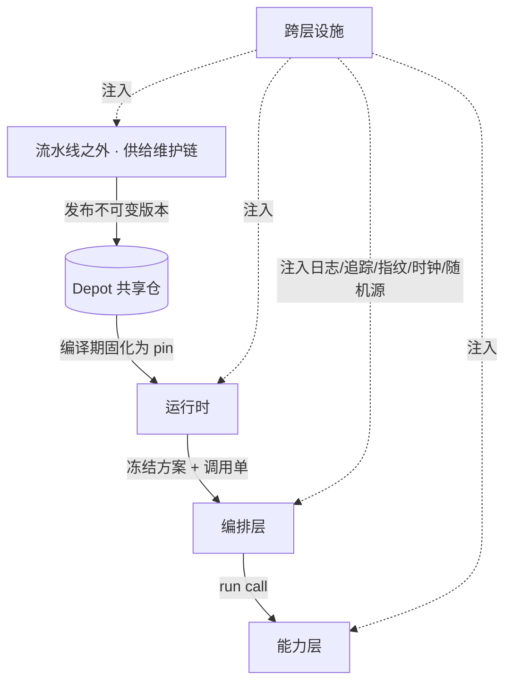

# S0 · 契约冻结

> 阶段目标：把七层的接口、数据结构、失败路径全部定死到「可以照着写实现、可以照着写拒绝测试」的粒度。
> 其中意图/编排/能力/事实在 01–06；应用层与存储层的契约在 `../09-app-storage.md`，加密口径约束在 `../10-crypto-fit.md`。
> **S0 不含任何因子计算、不含任何统计逻辑、不含任何数据读取实现。**

---

## 1. S0 到底是什么

S0 的交付物不是「能跑出结论的流水线」，而是**一套会拒绝的系统骨架**。

| S0 交付 | S0 不交付 |
|---|---|
| 七层的接口签名与调用协议 | 任何算法实现 |
| 七类核心数据结构与字段约束 | 任何面板 / 标签 / 指标计算 |
| 八个指纹的组成公式与规范化规则 | 任何统计检验 |
| 近二十条编译期校验（C1–C22）与全量运行期拒绝路径 | 任何数据采集 |
| 退出码、错误分层、结构化记录格式 | 任何组合优化 |
| 一条全哑的纵切（dummy 各层实现） | 真实的因子结论 |

**判断 S0 是否完成，只用一件事**：把十二个非法输入喂进去，是否每一个都被拒绝、都给出正确的错误码、都返回非零退出码。跑通一条正确的路径不算 S0 的验收——那在 S1。

### 为什么必须先做这一刀

这套系统的历史风险不是「算不出来」，是**算错了却显示成功**。假成功只会在两种地方被暴露：端到端真跑，和**故意喂错**。S0 把第二种做成自动验收：

> 一个从未拒绝过任何输入的系统，没有资格声称自己通过过任何一次输出。

因此 S0 的每一篇文档都必须回答三个问题：

1. 这一层**拿到**什么类型、**交出**什么类型；
2. 它**在什么条件下必须失败**，失败给什么错误码；
3. 它**绝对不许**做什么，这条禁令靠什么结构保证（而不是靠注释）。

---

## 2. 五层与依赖方向

五层的概念定义在上一级目录。S0 只关心**谁能调谁**。



四条方向约束，前三条被违反一律是契约违反（退出码 `3`）；第四条分两种，见下：

| 约束 | 内容 | 违反时 |
|---|---|---|
| **单向** | 上层可调下层，下层永不反向调上层。能力层不 import 编排层，编排层不 import 维护链 | `E2001` / 退出码 3 |
| **无全局状态** | 五层之间只通过显式参数与落盘引用通信，禁止模块级可变单例 | `E2001` / 退出码 3 |
| **设施只注入** | 跨层设施由最外层构造一次、逐层向下传，禁止任何层自己 `get_logger()` / `time.now()` / `random()` | `E2007` / 退出码 3 |
| **事实只读** | 执行期只有编排层写 Ticket 区，其余四层对 Depot 零写入 | **绕过句柄直接写 → `E2007` / 退出码 3**；**通过句柄尝试写 → `E5004` / 退出码 1** |

最后一行要分成两种失败，因为它们是两种病：**绕过设施**是代码写错了（契约违反），**句柄拒绝**是调用了一个不该调的方法（存储层正常拒绝）。合并成一个退出码，线上排查就会退化成猜。

第 3 条是 S0 最容易漏、也最值钱的一条：一旦某层能自己取时钟或随机源，「同方案同种子两次执行结果一致」就再也无法证明。

---

## 3. 六篇文档

按**构建依赖顺序**编号，不是概念顺序。下层先定，上层才有落脚点。

| 文件 | 冻结什么 | 关键产出 |
|---|---|---|
| `01-data-contracts.md` | 七类核心类型、八个指纹、错误分层、退出码、序列化格式 | 全局唯一的类型字典 |
| `02-crosscutting.md` | 日志、追踪、计时、随机源、指纹服务、缓存、告警 | 七个设施接口 + 禁令 |
| `03-runtime.md` | 四区存储、配置编译十步、C1–C22、环境快照、门禁 B | 编译产物的完整字段表 |
| `04-capability.md` | `run(call)` 协议、`describe()`、参数 schema、十二项能力签名、算法四方法 | 能力目录格式 |
| `05-orchestration.md` | 工位规格、唯一执行入口、八工位产物 schema、状态机、事件、单步、失效 | 执行器 13 步流程 |
| `06-upstream.md` | 维护链命令面、门禁 A、原子发布、租约、维护日志 | 版本目录与清单格式 |

阅读顺序建议：`01 → 02 → 03 → 04 → 05 → 06`。若只想判断可行性，读 `01` §2（指纹）与 `05` §2（执行器流程）即可。

---

## 4. 建议的代码布局

```
v5/
  contracts/            # 01：只剩类型与校验，无业务
    types.py            #   Digest / Ref / Pin / Call / Parcel / Ticket / Blueprint
    digest.py           #   规范化 JSON 与八个指纹公式
    errors.py           #   错误分层与错误码常量
    exit_codes.py
  facilities/           # 02：七个设施，全部依赖注入
    log.py  trace.py  clock.py  rng.py  digest_svc.py  cache.py  notify.py
  runtime/              # 03
    charter.py          #   基线、计划、目录的加载
    compiler.py         #   十步编译 + C1–C22
    envelope.py         #   环境快照
    store.py            #   四区读写与权限校验
    gate_b.py           #   只读适用性门禁
  capability/           # 04
    registry.py         #   名字 → 实现@版本
    spec.py             #   describe() 与 param_schema 校验
    ops/                #   十二项能力的契约壳（S0 只抛 NotImplemented）
  orchestration/        # 05
    station.py          #   StationSpec 表（八行）
    executor.py         #   唯一 execute()
    state.py            #   状态机与失效传播
    events.py           #   Reveal / Budget / Publish
    cli.py              #   核心五条：run / station / explain / inspect / stations
                        #   （其余业务命令随 S5–S7，清单见 09 §2.2）
  upstream/             # 06
    acquire.py  gate_a.py  publish.py  lease.py
  storage/              # 09：物理层，只有事实层与维护链可以 import
    layout.py           #   路径唯一定义（任何模块不得拼 "facts"/"parcels"）
    objects.py          #   parquet 读写 + 内容寻址
    ledger.py           #   append-only jsonl（真相）
    index.py            #   duckdb 查询面（可重建）
    gc.py  reconcile.py
  app/                  # 09：应用层，CLI 只是其中一个壳
    contract.py         #   命令清单：名 / 参数 schema / 输出 schema / mutation 等级
    cli/                #   argparse 实现，逐命令一个文件
    render/             #   table / json / ndjson
```

`capability/ops/` 在 S0 里只有签名与 `NotImplemented`，这是刻意的：S0 要能证明「调用链与拒绝路径是通的」，而不是证明「算得对」。

---

## 5. 错误分层与退出码

错误分五类，**类别决定退出码**，不按模块分。这样调用方只看退出码就知道该找谁。

| 类 | 前缀 | 含义 | 典型场景 | 退出码 |
|---|---|---|---|---|
| 用法与配置 | `E1xxx` | 用户输入不合法 | 未知路径、拼错名字、参数越界、构成性参数越权 | **2** |
| 契约违反 | `E2xxx` | 系统自身不变量被破坏 | 单向依赖被反转、Parcel 不可变被违反、指纹不匹配 | **3** |
| 执行失败 | `E3xxx` | 工位在合法输入上失败 | 依赖缺失、重建失败、工位抛错 | **1** |
| 供给失败 | `E4xxx` | 事实层不可用或不适用 | 门禁 A 不通过、版本缺失、末端未闭合 | **4** |
| 存储与 IO | `E5xxx` | 落盘、权限、并发 | 目录不可写、租约冲突、校验和不符 | **1** |

退出码：

| 码 | 语义 | 谁用 |
|---|---|---|
| `0` | 成功 | 全部命令 |
| `1` | 执行或存储失败 | `flow run`、`flow station` |
| `2` | 用法或编译错误 | 全部命令 |
| `3` | 契约违反（按 bug 处理，必须 fail-closed） | 全部命令 |
| `4` | 供给失败 | 编译、`supply` 子命令 |

`3` 与 `1` 必须分开：前者说明「代码写错了」，后者说明「输入或环境有问题」。合并成一个码，线上排查就会退化成猜。

**没有 `0` 以外的「成功但有警告」**。警告可以存在，但只能进结构化记录，不能改变退出码，也不能让一次本应失败的执行返回 0。

---

## 6. S0 验收清单

十二条，全部可脚本化。每条都必须能构造出「坏输入」，并断言错误码与退出码。

| # | 验收项 | 构造的坏输入 | 期望 |
|---|---|---|---|
| **S0-1** | 未知配置路径 | 计划里写 `target.horizn` | `E1001` + 退出码 2 |
| **S0-2** | 拼错实现名 | `search.algorithms[0].name = gp_symbolc` | `E1002` + 退出码 2 |
| **S0-3** | 多余参数 | 给 `gp_symbolic` 传 `max_dept` | `E1003` + 退出码 2 |
| **S0-4** | 参数越界或类型错 | `population: "many"` | `E1004` + 退出码 2 |
| **S0-5** | 构成性参数越权覆盖 | 命令行改 `target.horizon` | `E1005` + 退出码 2 |
| **S0-6** | 缺裁决者 | 严格模式下不注入 Sentinel | `E1006` + 退出码 2 |
| **S0-7** | 数据版本缺失 | 别名指向不存在的版本 | `E4001` + 退出码 4，**且不创建 Ticket** |
| **S0-8** | 数据不适用 | 覆盖区间不含本计划时间轴 | `E4002` + 退出码 4，**且不触发采集** |
| **S0-9** | 上游缺失 | 单步跑 Panel 但无 ScopeParcel | `E3001` + 退出码 1，附修复提示 |
| **S0-10** | 指纹失配 | 手改 ScopeParcel 内容不改 digest | `E3002` + 退出码 1 |
| **S0-11** | 能力越权 | 能力实现体内尝试取时钟或写 Depot | `E2001` + 退出码 3 |
| **S0-12** | 静默降级 | 让某工位返回 `None` 产物 | `E3003` + 退出码 1，**不得记为成功** |

外加一条正向冒烟（不算验收，只证明链路通）：八工位各用 dummy 实现，从 Boundary 跑到 Certify，产出八个 Parcel、八条 trace、一个 Ticket 目录，退出码 `0`，且**没有任何一步产出真实数字**。

---

## 7. 与 S1 的交接条件

S0 结束、S1 开始，必须同时满足：

1. 十二条验收全绿，且每条有自动化测试；
2. `flow explain` 能输出逐叶子来源与 C1–C22 逐条结果；
3. 八个 `StationSpec` 与十二项能力签名冻结，S1 不改接口；
4. 八个指纹的公式有单元测试，任何字段增删都能被测试发现；
5. 一次 dummy 纵切能在全新进程中重放并得到逐位一致的 `parcel_digest`。

第 5 条是 S0 真正的门槛：它同时证明了「落盘可重建」与「指纹稳定」两件事。

**S1–S7 的范围、交付与退出门槛不在这六篇里**，见 `../12-stages.md`。S0 只定义自己这一刀。

---

## 8. S0 明确的非目标

| 不做 | 留给 |
|---|---|
| 真实数据接入与字段语义 | S2 |
| 真实算法与搜索空间 | S3 |
| 成本、成交、资金费的真实口径 | S4 |
| 单步 `--commit` 与账本推进 | S5 |
| 日志轮转、缓存淘汰的真实策略 | S6 |
| 组合域的成员枚举与退役监控 | S7 |

S0 里这些位置**只留接口与 `NotImplemented`**。留空不是省略，是为了让「哪一层还没实现」在运行时就是一个显式错误，而不是一个看似成功的空产物。

每个阶段的目标、交付、退出门槛与「不许提前做的事」，见 `../12-stages.md`。
